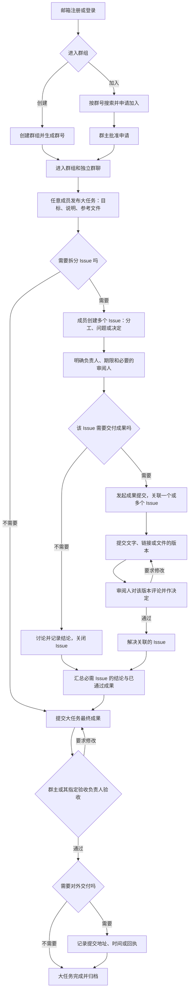

# Temori 网页端协作流程草案

> 这是用于讨论的宏观流程，不是已经确定的界面或技术规格。首版面向课程小组，之后再用真实团队验证竞赛和志愿活动的差异。

## 五个核心对象

| 对象 | 用途 |
| --- | --- |
| 群组 | 持续存在的协作空间，包含成员、群号、群聊和多个大任务。 |
| 大任务 | 一次共同目标，例如完成课程展示或比赛报名；包含目标、说明、期限和参考文件，按需要创建 Issue。 |
| Issue | 大任务下的一件待办或待讨论事项，记录要解决什么、由谁负责以及讨论结论。 |
| 成果提交 | 记录做出了什么，可关联一个或多个 Issue，也可直接提交到大任务；包含文字、链接或文件，修改后产生新版本。 |
| 审阅与验收 | Issue 成果由指定审阅人评论并决定是否通过；大任务最终成果由群主或其指定的验收负责人验收。 |

## 从组队到完成

群聊贯穿整个过程，适合快速交流；需要拆分时，分工决定和讨论结论记录在 Issue 中，审阅意见记录在成果提交的对应版本中。简单任务可以不建 Issue，直接提交大任务成果，仍由群主或其指定验收负责人验收。

## 建议先定下的规则

- **群号用于找到群组，不等于加入权限。** 搜索结果显示群名和简介，默认提交加入申请，由群主批准；也可保留邀请链接作为后续入口。
- **群主与任务负责人分开。** 群主管理群组成员；任何成员都能发布大任务，其创建者默认负责协调，也可转交给其他成员。大任务负责人指定 Issue 负责人和审阅人。
- **Issue 按需创建，且不等于成果提交。** 需要拆分时，Issue 记录“要解决什么”，成果提交记录“做出了什么”，并可关联多个 Issue；问题或决策型 Issue 在记录明确结论后关闭。成员都可以提出 Issue。简单大任务可跳过 Issue，直接提交成果。
- **参考文件与成果版本分开。** 大任务中的附件说明“要做什么”；成果提交的版本记录“做出了什么”。审阅意见始终绑定到某个版本。
- **最终验收由群主负责。** 有 Issue 时，必需的 Issue 完成后由大任务负责人整理并提交最终成果；没有 Issue 时可直接提交。群主可为大任务指定一名验收负责人；未指定时由群主验收。任务负责人不自动获得最终验收权限；验收要求修改时保留此前版本。
- **区分内部通过与对外交付。** 如果课程、比赛或志愿任务还需交给外部负责人，最终验收后记录提交地址、时间或回执，再标记大任务完成。
- **关键节点通知相关人。** 加入申请、被指派、被提及、待审阅、要求修改和通过，都应有站内提醒。

## 待用户验证

- 邮箱登录是密码、验证码，还是同时支持两种方式？
- 群组是否需要支持无需审批直接加入？哪些群组会需要？
- 哪些讨论需要转为 Issue，哪些留在群聊即可？
